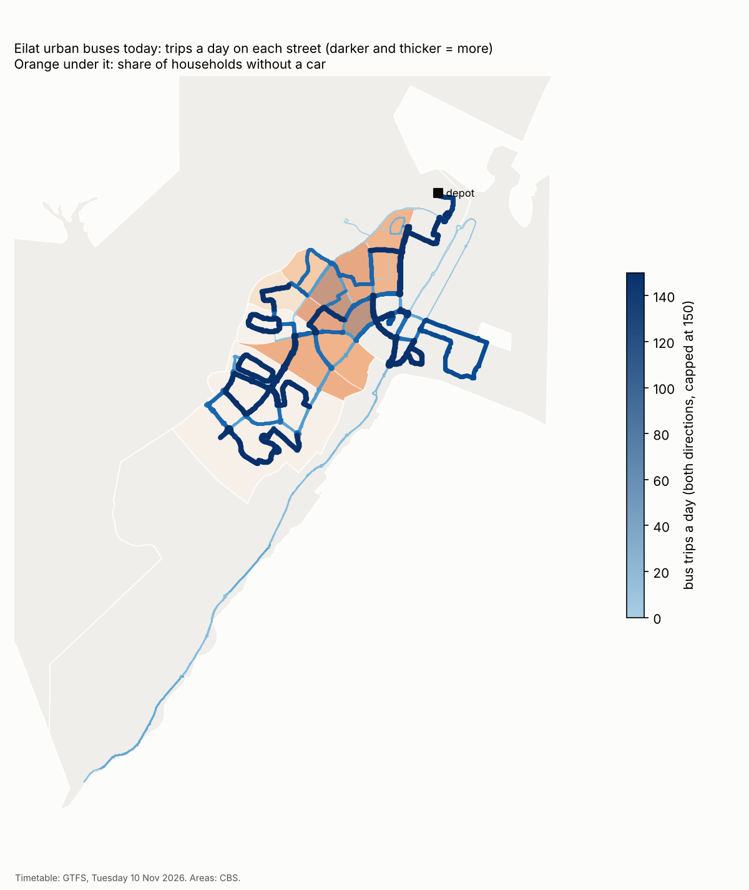
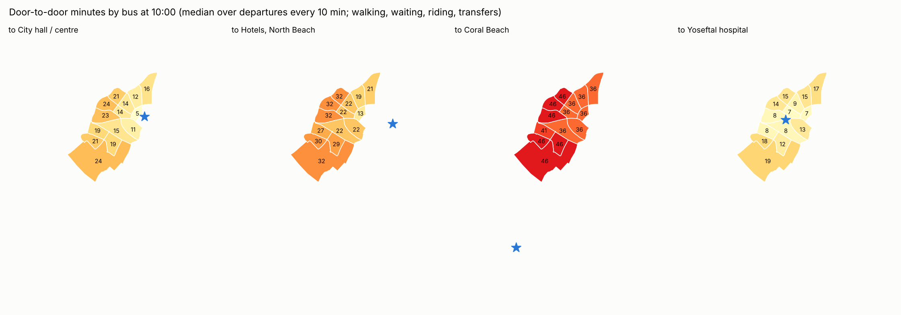

# Eilat: today's network and how long it takes to get places (baseline)

Timetable: GTFS for Tuesday 10 Nov 2026, urban lines only (`scripts/gtfs_eilat.py`):
- 441 planned trips on 15 lines, against ~445 measured in SIRI on school-term weekdays;
- 232 stops.

## The lines

| Line | Trips a day | First - last | Length (km) | Run time (min) |
|---|---|---|---|---|
| 3 | 102 | 05:15 - 23:05 | 10.4 | 23 |
| 4 | 98 | 05:25 - 22:35 | 10.4 | 28 |
| 2 | 51 | 06:10 - 23:00 | 22.3 | 55 |
| 1 | 44 | 06:05 - 23:05 | 22.5 | 56 |
| 5 / 5א | 31 + 14 | 06:30 - 21:30 | 24-26 | 62-68 |
| 6 / 6א | 26 + 15 | 08:00 - 22:00 | 24-25 | 63-68 |
| 15 / 16 (south coast, Taba) | 20 + 20 | 08:35 - 21:55 | 14-15 | 22-24 |
| 1א | 6 | 15:05 - 20:05 | 29 | 69 |
| 80, 80א, 81, 82 (schools) | 14 | 07:10 - 15:10 | 8-13 | 21-38 |

- **Two kinds of line.**
  - Short frequent lines: 3 and 4, every ~10 minutes.
  - Four long winding loops: 1, 2, 5, 6. They are 22-26 km long and take 55-68 minutes for a city that
    is about 5 km across, and they carry two thirds of all boardings (ridership file).
  - A loop that long means a slow ride for anyone going more than a few stops. Straightening or
    splitting the loops is the obvious thing to test.
- **Coverage follows the western neighbourhoods.** The densest service winds through the south-western
  areas (33-36), where few households lack a car (17%). The eastern areas, where 40-56% have no car,
  are served mostly along their edges.
- **The south coast is thin.** Lines 15 and 16 together run about 2 buses an hour at midday and 1 an
  hour mornings and evenings. Nothing runs before 08:30 or after 22:00.

## Door-to-door travel time

`scripts/access.py`. Connection Scan Algorithm on the timetable:
- **Origins:** 12 random points inside each residential area.
- **Walking:** up to 800 m to and from stops, transfers on foot up to 300 m, straight-line × 1.3 at
  4.5 km/h. Walking all the way is always allowed.
- **Departures:** every 10 minutes within each window. The median over them includes the wait a
  passenger who doesn't time the bus would have.

### City average, weighted by residents without a car (likely riders), minutes

| Destination | 07:00 | 10:00 | 13:00 | 17:00 | 21:00 | Walking (all residents) |
|---|---|---|---|---|---|---|
| Hospital | 13 | 13 | 13 | 13 | 14 | 20 |
| Goldwater / Rabin / Begin high schools | 15-17 | 16-17 | 16 | 16 | 17-18 | 21-25 |
| City hall / centre | 16 | 17 | 16 | 17 | 18 | 29 |
| Campus | 16 | 17 | 16 | 17 | 17 | 34 |
| Mall HaYam | 18 | 20 | 18 | 19 | 20 | 34 |
| Big centre | 19 | 19 | 19 | 19 | 21 | 44 |
| City entrance terminal | 22 | 22 | 22 | 22 | 23 | 52 |
| Hotels, North Beach | 25 | 25 | 24 | 24 | 26 | 44 |
| Ice Mall | 29 | 29 | 27 | 27 | 30 | 49 |
| Port | 32 | 29 | 29 | 31 | 32 | 40 |
| **Coral Beach** | **87** | 40 | 42 | 52 | **99** | 95 |
| **Taba / Princess** | **93** | 43 | 44 | 55 | **116** | 125 |

- **Inside the city the bus is reasonable but not fast.**
  - About 15-20 minutes door to door to the centre, schools and hospital, against 20-30 minutes on
    foot.
  - For the nearest destinations, walking is almost as quick. The bus saves the most to the
    city-entrance terminal, Big, the hotels and the malls.
- **The hotels and Ice Mall are 25-30 minutes from where residents live.** These are the city's
  biggest employers. From the south-west the trip is 30-32 minutes.
- **The south coast is the weak spot.**
  - About 40 minutes at midday from anywhere, 50+ at 17:00.
  - Before 08:30 and after 21:00 there is effectively no service: walking would be as fast.
  - Morning workers at the southern hotels and the Coral Beach reserve, and evening tourists, are not
    served.
- **Area 36 (about 10,000 residents) is the farthest from everything:** 24 minutes to the centre, 32 to
  the hotels and to the entrance terminal. Its residents mostly have cars (17% without), so this
  weighs less than its population suggests.

## Caveats

- This is the **planned** timetable. Delays and missed trips (SIRI shows the actual) are not included
  yet.
- Walking uses straight lines × 1.3. In Eilat's hills some walks are longer.
- The attractors are single points anchored on their nearest stops (see the code). The hotel strip,
  for example, is a line of hotels, not a point.
- Area 16's population is published together with area 15 (CBS), so area 16 has no weight of its own.
