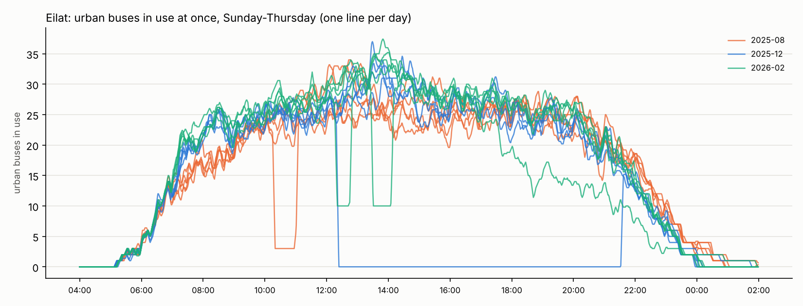

# Eilat: the fleet actually used (measured from SIRI)

Every SIRI report in and around Eilat for 21 whole service days, 04:00-02:00
(`scripts/fetch_siri.py`, `scripts/fleet.py`):

- one week each in August 2025 (summer holidays), December 2025 (school term, before Hanukkah) and
  February 2026 (school term, before the war);
- about 32,000 reports on a weekday.

**How it's measured:**
- A bus is **in service** from the first to the last report of each trip.
- A bus is **in use** if it is in service or in a layover of at most 20 minutes between two of its
  trips. This is the real fleet constraint: a bus waiting at a terminal is not free for another line.
- **Urban lines:** 1, 1א, 2, 3, 4, 5, 5א, 6, 6א, 10, 11, 15, 16, 80, 80א, 81, 82.
- **Airport / regional lines** (30, 30א, 31, 32, 50, 50א) are counted separately.
- **Left out:** intercity lines, and Eilot council lines 22 and 23.
- **Line names:** taken from the timetable valid on each day, since line codes changed between August
  and December.

**Excluded from the averages because of SIRI feed gaps:** 14 Aug (40 minutes missing), 8 Dec (most of
the afternoon), 16 Feb (25 minutes) and 19 Feb (a dip at 13:30).

## Urban lines, results

| Days | Season | Trips a day | Different buses | Peak at once (max / median) | Bus-hours in service | Bus-hours in use |
|---|---|---|---|---|---|---|
| Sun-Thu | Aug 2025 | 442 | 41 | 34 / 29 | 353 | 382 |
| Sun-Thu | Dec 2025 | 443 | 42 | 37 / 34 | 353 | 392 |
| Sun-Thu | Feb 2026 | 447 | 42 | 38 / 36 | 376 | 414 |
| Friday | all three | 245-281 | 38-41 | 29-32 | 191-213 | 210-233 |
| Saturday | all three | 70-101 | 14-18 | 12-13 | 48-64 | 54-75 |

**The constraint for the redesign** (school-term weekday, 2026 Q1):
- about **42 buses**, of which at most **36-38 are in use at once**;
- about **400-415 bus-hours** in use per weekday;
- with Friday and Saturday, about 2,400 bus-hours a week.

That matches press reports of "about 40 urban buses in Eilat".

## Through the day (average urban buses in use, Sun-Thu)

| Hour | 06 | 07 | 08 | 09 | 10 | 11 | 12 | 13 | 14 | 15 | 16 | 17 | 18 | 19 | 20 | 21 | 22 | 23 |
|---|---|---|---|---|---|---|---|---|---|---|---|---|---|---|---|---|---|---|
| Aug 2025 | 8 | 15 | 18 | 22 | 24 | 25 | 27 | 26 | 25 | 25 | 25 | 25 | 26 | 25 | 24 | **19** | **13** | **6** |
| Dec 2025 | 9 | 18 | 23 | 23 | 25 | 25 | 28 | 30 | 29 | 26 | 27 | 26 | 24 | 24 | 21 | 17 | 10 | 4 |
| Feb 2026 | 9 | **20** | **24** | 24 | 26 | 26 | 30 | **32** | **32** | 28 | 28 | 28 | 26 | 26 | 22 | 18 | 10 | 4 |

- **The schedule is seasonal.**
  - In school term, the morning (07:00-08:00) has more buses, and the daily peak is at 13:00-14:00,
    when schools let out.
  - In summer, the morning is lighter, the midday peak is flatter, and there are more buses late in the
    evening (21:00-23:00), which fits tourists and evening leisure.
- **The peak is short.** The fleet is set by 1-2 hours at midday. For most of the day 24-28 buses are
  in use, 10-14 fewer than at the peak.
  - For the redesign this is the key fact. Every bus added at 13:00-14:00 costs a whole vehicle; an
    extra bus at 10:00 or 17:00 only costs driver hours.
- **Eilat runs buses on Saturday:** 70-100 urban trips, mostly in the evening.

## Airport and regional lines (separate)

- Sunday to Thursday: about 150 trips a day, 10-14 buses at once, about 120 bus-hours in use.
- They use 20-40 different vehicles a day for a peak of 10-14, so these lines share buses with the
  intercity fleet. They are not part of the urban fleet constraint.

## Caveats

- In-use time misses positioning trips from and to the depot (deadheading), because buses don't report
  then. True vehicle-hours are somewhat higher.
- A trip seen in fewer than 3 reports is left out, which slightly undercounts.
- One week per season. December and February agree closely; August is a single summer week.
