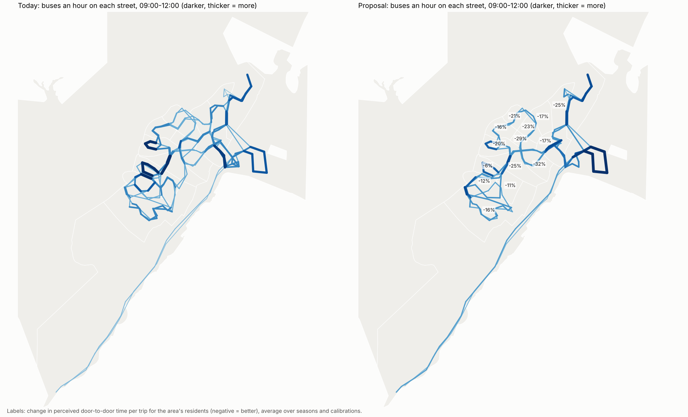

# Eilat bus network redesign

Can a city's buses serve people better with the same fleet and the same drivers? For Eilat, a closed city of
55,000 with ~42 urban buses, the answer from public data is **yes.**

**The recommended plan:**
- **~16% less perceived door-to-door time,** and every neighbourhood better off.
- **No extra buses:** 34, against today's 35.
- **No extra drivers,** with overtime as today. With realistic terminal recovery time it needs fewer than today.
- **Costs ~NIS 2.1 M a year** in extra bus-hours.
- **What riders pay:** about one bus trip in four needs a transfer, up from one in six.

**What changes:**
- Lines 1, 4 and 6א merge into 2, 3 and 6, which run more often.
- Lines 2 and 3 drop their detours (line 3: 31 → 24 min end to end).
- The long lines pass their quiet stops.
- A new line 7 runs campus – Star Eilat – hotels.
- Evening service runs to 23:00, plus five shift-change trips for the hotels and Yoseftal.



**Read first:**
- the [decision brief](https://claude.ai/artifact/EhZ6aFgBzyymEFFGG5fVSP) (Hebrew, `web/brief.html`);
- [SUMMARY_HE.md](SUMMARY_HE.md);
- [REDESIGN.md](REDESIGN.md), which also covers the two alternatives checked, the method, the checks and the
  caveats.

**Explore it:**
- the [interactive map](https://claude.ai/artifact/DJSeiVJX6hTwAZyhMu8nMV) (Hebrew): today's lines next to the
  plan's, frequencies by season and time of day, and travel times from every neighbourhood. Source:
  `web/eilat.html`, data built by `scripts/export_page.py`;
- the plan's timetable as GTFS: `exports/gtfs_eilat_proposal.zip`.

## What's in it

| Step | What | Where |
|---|---|---|
| Supply | Today's lines from the national GTFS; real run times from SIRI vehicle locations (real trips take 1.24 × the timetable) | `scripts/gtfs_eilat.py`, `analysis/runtime_factor.py` |
| Fleet | Buses actually running, measured minute by minute over 21 days: 42 buses, 36-38 at the midday peak | `scripts/fetch_siri.py`, `scripts/fleet.py`, [FLEET.md](FLEET.md) |
| Stops | What a stop costs: SIRI speed decomposition (11 s per scheduled stop) and a national regression (33 s) | `analysis/stop_cost.py`, [PARAMETERS.md](PARAMETERS.md) |
| Demand | Census areas and car ownership, schools, hotels, beaches, jobs; trips by purpose, period and season; logit bus vs walk | `eilat/demand.py`, `eilat/model.py`, [ATTRACTORS.md](ATTRACTORS.md) |
| Calibration | Rav-Kav boardings per line (2025 Q4): 14% error per line; out of sample 15% | `scripts/calibrate.py` |
| Evaluation | Frequency-based assignment with common lines; perceived time with walk, wait, transfer and heat weights | `eilat/evaluate.py` |
| Design | Candidate lines (detours cut, quiet stops passed, new direct lines) + simulated annealing under fleet, bus-hour, equity, coverage and usability constraints; seasonal timetables | `eilat/candidates.py`, `scripts/optimize.py`, `scripts/seasonal.py` |
| Timetables | Lines running per hour, rough driver duties, and the recommended plan as a GTFS feed with vehicle blocks (`exports/gtfs_eilat_proposal.zip`) | `scripts/active_lines.py`, `shifts.py`, `export_gtfs.py`, `exports/` |
| Riders | Example trips planned on the real timetables (today and the plan), as a trip-planner app does | `eilat/timetable.py`, `scripts/journeys_tt.py`, `analysis/timetable_trip.py`, `scripts/build_brief.py` |
| Checks | Sensitivity of every assumed number, capacity per bus, school dismissal waves, vehicle blocks and e-bus range, reliability, weekends, a future scenario with a new district | `scripts/assess.py`, `capacity.py`, `school_peaks.py`, `blocking.py`, `analysis/reliability.py`, `weekend.py`, `future.py`, `spur.py` |

## Data (all public)

- Ministry of Transport GTFS (via Open Bus Stride's archive)
- SIRI real-time bus locations (Open Bus Stride API, Public Knowledge Workshop)
- Ridership per line, CBS census 2022 and statistical areas, and Education Ministry institutions:
  data.gov.il and cbs.gov.il

Raw files are not committed (`data/raw/`, `data/siri/`). The scripts fetch them again.

## Run it

```bash
pip install -r requirements.txt
PYTHONPATH=. pytest -q tests                      # synthetic-network tests of the evaluator and fleet maths
PYTHONPATH=. python3 scripts/calibrate.py         # needs data/ (see the scripts' docstrings for the fetch steps)
PYTHONPATH=. python3 scripts/optimize.py keep 2000
PYTHONPATH=.:scripts python3 scripts/seasonal.py keep 400 && PYTHONPATH=.:scripts python3 scripts/assess.py keep
```

## Honest limits

- **The model compares networks.** It doesn't forecast ridership exactly.
- **Purposes:** the purpose mix isn't identifiable from 8 lines, so the plan must win under two
  calibrations (it does).
- **Who travels where is assumed** (sizes of the key places, by distance); only line totals are measured.
  Full Rav-Kav tap data would replace the assumption.
- **Timed transfers:** today lines 1 and 2 meet line 15 at Mall HaYam; the plan's timetable has to
  rebuild such connections.
- **Summer** (July-August) has no ridership data.
- **Not modelled:** a full driver roster (a rough duty check only), depot capacity and charging. The blocks show that e-bus charging is
  already needed today.
- **Shifolei HaHar:** its streets aren't available, so its spur is an assumption.
