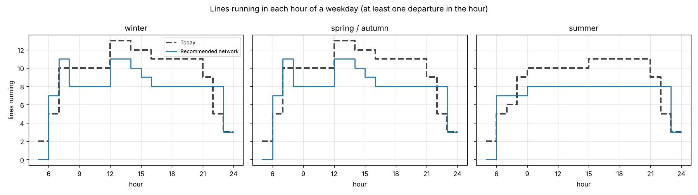

# Eilat urban buses: a better network on the same budget

**Answer: yes.**
- **No extra cost:** no more buses than today and about the same bus-hours, on existing streets and stops.
- **Shorter trips:** a reorganised network cuts the door-to-door time residents and tourists feel by
  **12-18%**, depending on how far the city wants to go.
- **No real losers:** no neighbourhood loses more than 3%.
- **Kept stops:** every hotel, the hospital, the campus, the malls and the terminals keep a stop.

Three options follow, from the most cautious to the most far-reaching. The interactive comparison is in
`web/eilat.html`. The method and every number are documented here:
- [PARAMETERS.md](PARAMETERS.md): the assumptions, with sources and tests;
- [ATTRACTORS.md](ATTRACTORS.md): the demand data and its weights;
- [FLEET.md](FLEET.md) and [ACCESS.md](ACCESS.md): today's network.

## How it was done

1. **Today's network.**
   - 441 urban trips on a weekday (GTFS, 10 Nov 2026).
   - Real run times from SIRI: trips take 1.24 × the timetable, and 1.5-1.7 × on the south coast.
2. **Demand.**
   - Residents of 14 census areas, with their car ownership; trips to work, school, services and leisure;
     hotel guests' outings. By period and season.
   - Calibrated on Rav-Kav boardings per line (2025 Q4): 14% error per line, 15% out of sample.
   - Two calibrations are kept (A fitted, B leaning on the prior purpose mix). Every option must win under
     both.
3. **Perceived time.**
   - Walk and wait count 1.6 × a minute on board; midday walking in the hot seasons counts 2.5 ×.
   - A transfer adds 5 min plus the real wait.
   - Lines sharing a street share riders.
4. **Rules.**
   - Budget: no more buses at once and no more bus-hours than today.
   - Equity and coverage: no area more than 10% worse, coverage kept.
   - Usable lines: every line runs 09:00-19:00 at least hourly; frequency changes ≤ 2 × between periods.
   - Protected stops: 27 stops for luggage, the hospital and the campus are never passed or cut, and must
     keep a line all day.
   - Existing stops only; school lines 80-82 unchanged.
5. **Search.**
   - Simulated annealing over today's lines plus candidates: detours cut, quiet stops passed, 42 new direct
     lines.
   - Then frequencies are tuned per season: one network, three timetables (winter, spring/autumn, summer
     holiday).

## What the search found

- **Pass the quiet stops on the long loops.** Lines 5, 6 and 6א pass 16-17 of their ~70 stops without stopping.
  Every one of them has another stop of the line close by.
- **More frequent service where it pays:** the hotel axis, the south coast in the evening, and evenings in
  general.
- **A flatter midday peak.** The fleet is set by 12:00-15:00.
- **Near-duplicate lines merged** (options 2 and 3): lines 1 and 2, and 3 and 4, each become one line at a
  higher frequency.
- **One new line, in options 2 and 3:** line 7 (a free urban number; the search's working name was A14H), a short shuttle (13-27 min) from the campus through area 14
  and Star Eilat to the hotels (Magic Palace / Crown Plaza).
  - The search added it to keep the campus and hotel stops served once lines 1 and 4 were merged away.
  - No other new direct line was chosen. In a city this size a frequent line through the centre beats a
    rare direct one.

## The three options

| | 1. Keep every line | 2. Restructure | 3. Restructure, fewer buses |
|---|---|---|---|
| Perceived door-to-door time vs today (calibration A / B) | **0.870 / 0.883** | **0.829 / 0.847** | **0.815 / 0.830** |
| With measured bus bunching (waits × 1.19) | 0.862 / 0.874 | 0.821 / 0.838 | 0.807 / 0.821 |
| Range over all sensitivity tests | 0.84-0.89 | 0.79-0.85 | 0.77-0.84 |
| Worst-off neighbourhood | up to +3% (areas 33-34, mostly car owners) | every area better | every area better |
| Buses at once (model, by season) | 34-35 (today 35) | 31-34 | 31-32 |
| Buses needed when trips are assigned to buses | 31-33 (today 35) | 30-34 | 30-34 |
| Bus-hours a weekday incl. layovers and depot runs | 508-534 (today 504) | 521-547 | 526-551 |
| Bus trips vs today (model elasticity) | +1% | +3% | +3% |

- **The fleet holds in every option.** Even when every trip is assigned to a real bus, no option needs more
  than today's 35.
- **Option 3's saving mostly disappears in real blocks.** It needs 30-34 buses, not 31-32, so its money
  advantage over option 2 is uncertain.
- **Paid bus-hours come out 1-9% above today** once real layovers are counted. The budget formula counts
  service time only. Aligning timetables between lines should absorb part of it; this has to be checked
  before claiming equal cost.

### Who gains and who loses (winter, 09:00-12:00, median change over areas, perceived minutes)

| Destination | Option 1 | Option 2 | Option 3 |
|---|---|---|---|
| Hotels, North Beach | +3 | **-6** | **-8** |
| Star Eilat / old central station | 0 | -4 | -7 |
| City hall | +1 | -2 | -4 |
| Hospital | +1 | 0 | -1 |
| Big centre | +4 | +4 | 0 |
| Coral Beach | +3 | -2 | +4 |

- **Option 1 at mid-morning is a little slower** to most places. Its gains come in the evening, at midday
  and on the coast.
- **Options 2 and 3 are faster to the hotels, the centre and Star Eilat,** but trips to Big are slower in
  option 2.
- Area-by-area numbers: `data/assess_<option>_areas.csv`, `data/assess_<option>_traveltime.csv`, and the
  interactive page.

## Stops

- **Protected (never passed, never cut, always served):** every stop named for a hotel, the hospital, the
  central station / Star Eilat, the city-entrance park-and-ride, the malls, the border crossings, the
  airport and the campus.
- **Why the coverage rule was added:** without it, the first runs dropped the Caesar hotel stop (~350
  boardings and alightings a day) and the campus stops.
- **Stops that lose all service** (full lists: `data/stops_<option>.csv`):

| | Stops no longer served | Their riders today (model) | Nearest served stop: median / max |
|---|---|---|---|
| Option 1 | 33 | ~400 a day | 73 m / 288 m |
| Option 2 | 31 | ~780 a day | 110 m / 268 m |
| Option 3 | 33 | ~680 a day | 40 m / 336 m |

- **Stops that some line passes:** another line still stops at every one of them.
- **The busiest stop dropped carries ~130 a day,** with another stop 67 m away.

## Will buses be overfull?

- **The busiest bus in the busiest hour** (1.5 × the period average):

  | | Riders on the busiest bus |
  |---|---|
  | Today | 78 (line 16, summer evenings) |
  | Option 1 | 78 |
  | Option 2 | 69 |
  | Option 3 | 71 |

- **None is over a full 12 m bus** (~85). Today and options 1-2 each have 4 line-periods above the
  comfortable 65; option 3 has 2.
- **School bells are staggered,** so classes leave over ~13:15, 14:10, 15:00 and 15:45 (estimated from the
  Education Ministry's weekly hours).
  - The biggest wave is 400-480 students per comprehensive school at 14:10.
  - The buses passing within 300 m in the next 15 minutes could take most of them even before
    corrections. After allowing for direction and for riders already on board, they overflow only if
    more than ~20% of the students leaving at one bell ride, 2-5 × the estimate.
  - School lines 80-82 stay.

## Timetables, buses and charging (`scripts/blocking.py`)

| | Buses | Bus-hours | km per bus a day (mean / max) | Buses over 250 km | Driver shifts (rough) |
|---|---|---|---|---|---|
| Today | 35 | 504 | 248 / 300 | 23 | 71 |
| Option 1 | 31-33 | 508-534 | 264-287 / 341 | 21-29 | 76-83 |
| Option 2 | 30-34 | 521-547 | 270-284 / 346 | 24-27 | 84-87 |
| Option 3 | 30-34 | 526-551 | 268-299 / 341 | 24-29 | 86-89 |

- **Most buses already run more than an e-bus's ~250 km a day,** so charging in the 10:00-12:00 lull is
  needed today and in every option. The depot is next to the centre.
- **Driver shifts:** the last column is a first count (bus hours / 8.5). The proper check, with the law's
  break rules and the cost, is in "Driver duties and their cost" below.

## Lines running by hour (`scripts/active_lines.py`)

| Departures a weekday, winter | 05-06 | 21-22 | 22-23 | 23-24 | Whole day |
|---|---|---|---|---|---|
| Today | 5 | 21 | 10 | 3 | 441 |
| Option 1 | 0 | 27 | 27 | 27 | 471 |
| Option 2 | 0 | 23 | 22 | 23 | 482 |
| Option 3 | 0 | 28 | 28 | 28 | 516 |

- **Evenings are where the options spend their hours.** Today most lines stop around 21:00. Every option
  keeps 8-10 lines running until midnight.
- **No option has trips before 06:00, because the model's day starts at 06:00.** Today 5 trips of lines 3
  and 4 leave between 05:15 and 06:00 towards the park-and-ride at the city entrance, for early shifts and
  intercity connections. **Keep them** in any option. They cost about 2 bus-hours a day.
- **Fewer lines at once** in options 2 and 3 (8-12 lines in daytime against today's 10-13) is the merging. The lines that
  remain run more often.

## Driver duties and their cost (`scripts/shifts.py`)

**Split shifts are not the problem; headcount is.** Every option can be staffed within Traffic Regulation
168, and no option needs more split shifts than today. But the evening service to midnight makes bus days
longer than two shifts can cover, so each option needs **10-17 more drivers** (1 for option 3 with overtime).
Their cost is moderate: **NIS 0.4-1.4 M a year**, i.e. 4-9% more paid driver hours.

What the law says (Regulation 168(a), gov.il):
- at least 7 h rest before a working day;
- at most 12 h driving in 24 h, 68 h in 7 days;
- a break of at least 30 min in every 4 h of continuous driving;
- a 25 h rest in every 8 days.

The check, step by step:
1. **Cutting bus days into duties.** Each bus day is cut at the depot and otherwise into the fewest
   near-equal duties.
2. **Two cases.** "standard": duties of at most 8.5 h; "overtime": a duty may run to 10.5 h, with the last
   2 h paid × 1.25.
3. **Breaks.** If a driver would drive more than 4 h without a 30-min layover, a spare driver takes one trip
   (paid 1 h; one spare does about 6 such reliefs a day).
4. **Short pieces.** A piece under 4 h is paired into a split shift (gap ≥ 1 h unpaid, spread ≤ 13 h), or
   given as up to 2 h overtime after a straight shift, or else paid at least 4 h.
5. **Cost.** Assumptions:
   - NIS 83 an hour: the authority's proposed floor of 55.18 + a 6 NIS/h retention grant (Oct 2026),
     × 1.35 employer cost; tested 70-100;
   - NIS 60 per split shift; tested 0-120;
   - headcount = the busiest season's daily duties × 1.25, for rest days, holiday and sickness.

| Weekday, vs today | Split shifts a day (today 4) | Extra drivers, standard / overtime | Paid driver hours | Extra cost a year, NIS M (range) |
|---|---|---|---|---|
| Option 1 | 0-5 | +14 / +11 | +3.8% / +4.9% | 0.50 (0.41-0.61) / 0.65 (0.53-0.80) |
| Option 2 | 0-4 | +17 / +10 | +4.6% / +6.2% | 0.59 (0.47-0.74) / 0.81 (0.66-1.00) |
| Option 3 | 0 | +17 / +1 | +6.7% / +8.9% | 0.84 (0.64-1.09) / 1.14 (0.89-1.44) |

Today's network in the same model needs 84 duties a day, 105 drivers ("standard") or 94 ("overtime").

- **Where the extra drivers come from.**
  - Today most buses finish around 22:00, so a bus day of ~17 h is two shifts.
  - In the options many buses run to midnight; a day of ~19 h becomes three shorter shifts.
  - Overtime brings it back to two shifts, at the cost of more paid hours.
- **The cost is not extra to the bus-hour gap.**
  - Driver pay is part of the NIS 360 per bus-hour, so the NIS 0.5-4.9 M a year for 1-9% extra
    bus-hours (above) already contains most of it. (An earlier version of this report said "up to NIS
    1.5 M"; that was an arithmetic error.)
  - What it adds is the labour side: 10-17 more people to hire.
- **Can Eilat hire them?** Israel is short of more than 5,000 bus drivers. Eilat is remote. Hiring 10-17
  more is the real risk, more than the money.
- **Ways to reduce it:**
  - end the late-evening service at about 23:00 in the quiet seasons;
  - let the second shift of a long bus day run with overtime;
  - roster with a real crew-scheduling tool, whose result is usually better than this check.
- **Not included:** one-off recruiting and training costs; Friday and Saturday crews.
- **Not validated:** the model's 105 drivers for today could not be checked against the operator's real
  roster, so the differences matter more than the levels.

## Ending the evening earlier (`scripts/evening.py`)

The extra drivers come from the evening service to midnight. Here each option ends its last departures
earlier, and the model re-checks it. Duties use the same Regulation 168 rules as above. "Overtime" lets the
second shift of a long bus day run to 10.5 h; Israeli drivers commonly work such days today.

Year averages vs today:
- **Time:** perceived time, mean of calibrations A and B.
- **Worst area:** the worst area in any season or calibration.
- **Cost:** operating cost = extra bus-hours × NIS 360, all costs including drivers.

| Option | Evening ends | Time | Worst area | Extra drivers, standard / overtime | Bus-hours | Operating cost a year |
|---|---|---|---|---|---|---|
| 1 | midnight (as proposed) | −12.4% | +2.9% | +14 / +11 | +5.1% | +NIS 2.7 M |
| 1 | 23:00, winter + spring/autumn | −10.6% | +3.7% | +9 / +5 | −0.5% | −NIS 0.3 M |
| 1 | 23:00 all year | −10.2% | +5.3% | +4 / +5 | −1.3% | −NIS 0.7 M |
| 1 | 22:00, winter + spring/autumn | −7.9% | +6.6% | +9 / +2 | −5.8% | −NIS 3.1 M |
| 2 | midnight (as proposed) | −16.2% | −0.7% | +17 / +10 | +7.4% | +NIS 4.0 M |
| 2 | 23:00, winter + spring/autumn | −14.8% | +0.2% | +9 / +1 | +1.9% | +NIS 1.0 M |
| **2** | **23:00 all year** | **−14.4%** | **+1.1%** | **+4 / +1** | **+1.0%** | **+NIS 0.5 M** |
| 2 | 22:00, winter + spring/autumn | −12.4% | +2.7% | +9 / −4 | −2.8% | −NIS 1.5 M |
| 3 | midnight (as proposed) | −17.7% | −1.8% | +17 / +1 | +9.1% | +NIS 4.9 M |
| 3 | 23:00 all year | −15.8% | −0.1% | +9 / −2 | +3.1% | +NIS 1.7 M |
| 3 | 22:00, winter + spring/autumn | −13.5% | +2.6% | +14 / −2 | −1.9% | −NIS 1.0 M |

How the earlier end enters the model:
- The model has one evening period (19-24), represented by its average headway, exactly as it represents
  today's network (whose evening already thins out after 21:00).
- Ending at 23:00 stretches that average × 5/4; ending at 22:00, × 5/3.
- Today's 3 departures after 23:00 are cut too, and the worst-area column carries that.

- **Ending at 23:00 removes most of the extra-driver problem and most of the extra cost.** It keeps 80-90%
  of each option's gain.
- **The realistic package is option 2 ending at 23:00 all year, with overtime as today** (plus four hotel
  shift trips, below: +2 drivers, +NIS 0.9 M a year):
  - 14% shorter perceived trips;
  - no area more than 1.1% worse than today;
  - one more driver;
  - about NIS 0.5 M a year more.
- **Without merging lines, option 1 ending at 23:00 costs less than today** (−NIS 0.7 M) and still gives
  10%. It needs 4-5 more drivers.
- **Ending at 22:00 in the quiet seasons is the cheapest, but it cuts service that runs today.** That is
  what the worst-area column shows: up to 6.6% worse in option 1.
- **Option 3's saving in buses never materialises in real blocks.** Its bus-hours stay 3% above today even
  at 23:00.

### Keeping the 23:00 shift changes: hotels and Yoseftal (`scripts/shift_trips.py`)

**Ending every line at 23:00 would strand hotel and hospital staff.** Today's timetable is a strong hint:
- loops 1 and 2 pass the North Beach hotels at 23:21-23:28 and 23:51-23:58;
- line 3 passes Yoseftal hospital at 23:16;
- all of these fall just after a 23:00 shift end.

Shift times are an assumption:
- 07-15-23 is the common pattern;
- Eilat job postings also show 06-14-22, and some hotels run staff shuttles;
- the hotels' and the hospital's real shift times and staff numbers should be asked for before the
  timetable is fixed.

**The fix: five shift trips.** Each option keeps 5 trips after 23:00, as today:
- 4 at the hotels: two lines × two passes, on the lines that reach the most residential stops after the
  hotels;
- 1 at the hospital.

Each trip reaches its first stop 15 min after the shift ends: clocking out, changing and walking to the stop
(an assumption).

| Evening ends at 23:00 | Shift trips on | Extra drivers, standard / overtime | Operating cost a year |
|---|---|---|---|
| Option 1, no shift trips | – | +4 / +5 | −NIS 0.7 M |
| Option 1 + 4 hotel trips | 1, 6א | +4 / +4 | NIS 0.0 M |
| Option 1 + 4 hotel + 1 hospital trip | 1, 6א, 3 | +6 / +5 | NIS 0.0 M |
| Option 2, no shift trips | – | +4 / +1 | +NIS 0.5 M |
| Option 2 + 4 hotel trips | 6, 6א | +6 / +2 | +NIS 0.9 M |
| **Option 2 + 4 hotel + 1 hospital trip** | **6, 6א, 3** | **+9 / +4** | **+NIS 1.4 M** |
| Option 3 + 4 hotel + 1 hospital trip | 2, 6, 3 | +9 / 0 | +NIS 2.1 M |

- **Five late trips cost NIS 0.7-0.9 M a year in option 2, but read this as a range.** The block and duty
  heuristics are lumpy:
  - one isolated late trip can open a new bus day or a 4-hour minimum duty;
  - in option 1 the same trip costs nothing;
  - a real scheduling tool would hang these trips onto buses already out.
- **Perceived time is about as in the 23:00 rows above.** The shift trips are not in the evaluation's
  evening average.
- **Early shifts:** a 07:00 start is reachable in every option, since the first buses leave at 06:00. A
  06:00 start is not reachable today either; today's 05:15-05:55 trips go to the city entrance, not the
  hotels.
- **Time to reach the stop:** the school dismissal check now counts buses from 7 min after the bell.
  Buses still have room for at least 8 times the students who take them.

## Realism checks on the recommended package (`scripts/realism.py`)

The package is option 2, evening to 23:00, with the shift trips. Each check compares it with today's
network under the same rule.

| Check | Today | Option 2 | Reading |
|---|---|---|---|
| **Recovery time at terminals**: layover max(5 min, 15% of the run), since SIRI shows 41% of trips >5 min late | 37 buses, 101 drivers | 34 buses, 102 drivers, +2.2% bus-hours (+NIS 1.2 M) | Today's timetable needs 37 buses with this slack, which matches the 36-38 measured out at midday (FLEET.md); option 2 keeps 34. With 10%: 35 vs 34 buses, equal drivers, +3.3% bus-hours. |
| **Transfers**: bus trips needing one (residents × key places × periods, winter) | 17.5% | 24% | The merges add transfers. Connections between two lines that both run ≥ every 30 min: 0.9% today, 0.1% option 2. |
| **Dropped stops** (no longer served) | – | 31 stops, 781 boardings a day today | Nearest served stop: median 110 m, max 268 m. Only one is in an area with ≥15% residents aged 65+ (חטיבת הנגב/דרך הגיא, area 32, 95 m to the next stop). |
| **Passed stops** (quiet stops a line skips) | – | 24 stops, 94 boardings a day | Next served stop: median 73 m, max 177 m. |
| **Buses an hour at the busiest stop** (midday) | 18 (city entrance) | 20 (city entrance) | Well under the 30-40 a kerbside stop with one berth handles. |
| **Holiday peak** (Passover, Sukkot: hotels full, 2.6 guests a room, schools out), busiest hour | 67 on line 16 | 63 on line 5 | Both near the comfortable 65, under the 85 of a full bus. |

- **What realistic recovery time means:**
  - it raises the bill for any network, today's included;
  - against today under the same rule, option 2 costs NIS 1.2-1.8 M a year more and needs 0-1 more drivers.
- **Transfers are the main price of option 2.** About one bus trip in four needs a change, up from one in
  six.
  - The 5-minute transfer penalty is the literature value; the design also wins with 10.
  - Whether a transfer costs a second fare in Eilat, and whether residents ride free, could not be
    confirmed here. Check with the Ministry before the change.

**All in, the realistic cost of the recommended package:**
- NIS 1-2 M a year more than today, and 2-4 more drivers;
- for 14% shorter perceived trips;
- it stays within today's 35 buses.

## Example trips on the real timetable (`analysis/timetable_trip.py`)

The model represents each period by its average headway, and a rider's wait as half of it. For single trips
that can mislead, so three examples were re-planned on the actual timetables, the way a trip-planner app
does it:
- today's GTFS;
- option 2's exported GTFS (winter, measured run times).

| Trip | Today (timetable) | Option 2 (timetable) | Model's average, today → option 2 |
|---|---|---|---|
| Home by שד.ששת הימים → Princess hotel, for a 07:00 shift | first possible arrival **08:59** (line 15 starts 08:35) | first arrival **07:14** | 129 → 54 min |
| Same home → Coral Beach, 20:00-22:00 | 27-72 min until 20:45; **no bus after that** | 32-52 min, until after 22:00 | 96 → 44 min (at 21:00) |
| Area 36 → North Beach hotels, 20:00-22:00 | 33-55 min | 35-46 min | 78 → 35 min |
| Area 33 → city-entrance park & ride, 20:00-22:00 | 19-34 min (mean 24) | 36-52 min (mean 45) | 30 → 53 min |

- **The direction holds; the size doesn't always.**
  - The model's averages overstate the evening hotel trip: today's real timetable already does it in
    33-55 min.
  - They understate the Coral Beach evening: today there is no bus at all after about 20:45.
- **A 07:00 shift on the south coast is still missed in option 2,** by 14 min. One earlier line-15 trip
  (from the central station at about 06:15) would fix it.
- **Today's timetable has timed transfers the model doesn't credit.** At Mall HaYam:
  - line 1 arrives just as line 15 leaves at :19 every hour;
  - line 2 arrives 6 min before line 15 leaves at :49.
  - Option 2 removes line 1. Its new timetable should recreate such connections (with lines 2 and 5) when
    timetables are aligned in the preparation phase.
  - The exported GTFS does not design them.

## GTFS export (`scripts/export_gtfs.py`)

Each option is in `exports/gtfs_<option>.zip`:
- weekdays Sun-Thu, with three seasonal timetables over Nov 2026 - Oct 2027 (`calendar_dates.txt`);
- the recommended evening: last departures before 23:00, plus the 5 shift-change trips;
- measured run times;
- quiet stops left out of the lines that pass them;
- school lines with today's real trips;
- a `block_id` per trip, from the vehicle blocks.

The export checks every reference, stop sequence and time, and that every trip has a bus. Trip counts
match `data/blocking.csv`. No holidays are marked, and Friday and Saturday are not included.

## Phased introduction

1. **Prepare (2 months).**
   - Walk every passed stop, for accessibility.
   - Ask for stop-level Rav-Kav data.
   - Hand the GTFS to the operator.
   - Align timetables between lines to close the bus-hour gap.
2. **Option 1 ending at 23:00, with today's pre-06:00 trips kept.**
   - Every line and number stays.
   - It gives ~10%, costs about what today does, and needs 4-5 more drivers.
3. **Measure 3-6 months.**
   - Boardings per line, SIRI lateness, complaints.
   - Go on only if trips haven't fallen and no area lost more than expected.
4. **Option 2 (ending at 23:00) in two steps.**
   - Run line 7 as a pilot next to lines 1 and 4; merge 1 and 4 only if line 7 holds its riders.
   - That takes the gain to ~14% with one driver more than today, for about NIS 0.5 M a year.
5. **With the new districts:** the Shifolei HaHar spur (+3 buses justified by the new demand), planned on
   the real street map.

**Option 3 is not recommended now.** Its saving in buses mostly disappears in real blocks.

A Hebrew decision summary is in [SUMMARY_HE.md](SUMMARY_HE.md).

## Reliability (SIRI)

- **Gaps between buses vary** (CV 0.43), so a random passenger waits 19% longer than the timetable implies.
- **Lateness at mid-route:**
  - median +3.5 min; 41% of trips more than 5 min late;
  - loops 1, 2 and 6 run 8-9 min late half-way round because their timetables are optimistic.
- **The options use measured run times,** and score slightly better against today once bunching is
  counted.

## Friday and Saturday (`scripts/weekend.py`)

- **The weekend scale is calibrated** on Rav-Kav weekly minus 5 × weekday boardings (2025 Q4).
- **Each option keeps its weekday lines,** with frequencies tuned per day under today's same-day budget, and
  only in hours that have service today: Shabbat hours are a policy, not a model choice.
- **Friday:** 13-15% better in every option, with fewer buses at the peak (23-27 against today's formula
  budget of 33).
- **Saturday:**
  - no better evening timetable was found within today's ~70 bus-hours;
  - options 1-2 overshoot the budget and option 3 stays within it but is a little worse;
  - **recommendation: keep today's Saturday timetable.**

## The future: Star Eilat, the old airport district and Shifolei HaHar

- **Demand.** The planned districts add ~12,300 residents, ~5,900 jobs and ~3,150 hotel rooms. Bus trips
  grow by **8-10%**, which justifies about **+3 buses and +32-40 bus-hours**.
- **On today's budget, without re-tuning,** the options stay better than today's network:
  - option 1: 0.91-0.93;
  - option 2: 0.87-0.90;
  - option 3: 0.86-0.88.
- **The old airport district** has stops ~200 m away.
- **Shifolei HaHar** is ~850 m from the nearest stop and gets a **spur**: lines 5 and 6 leave Yahel St.,
  serve 3 new stops and return (~1.2 km each way, ~9-10 min a trip).
  - The district's streets aren't available here (OpenStreetMap is blocked from this environment), so the
    spur is an assumption.

| Under future demand | Without spur | With spur | Shifolei HaHar residents | Peak buses | Bus-hours |
|---|---|---|---|---|---|
| Option 1 | 0.91 | **0.85-0.86** | 0.99 → **0.47** | 35 → 36 | 394 → 419 |
| Option 2 | 0.87-0.88 | **0.81-0.82** | 1.00 → **0.47** | 34 → 35 | 395 → 422 |
| Option 3 | 0.85-0.86 | **0.79-0.80** | 1.00 → **0.47** | 32 → 34 | 404 → 431 |

The spur fits within the budget growth the extra demand justifies.

## How robust is the design? (three more searches from scratch, random seeds 11-13)

| | Today's lines kept | Long loops passing quiet stops | Lines merged | New lines | Result |
|---|---|---|---|---|---|
| Seed 11 | all 8 families | 1, 2, 4, 5א, 6, 6א | none | none | 0.917 |
| Seed 12 | all 8 families | 1, 2, 4, 5, 5א, 6, 6א, 15, 16 | none | none | 0.915 |
| Seed 13 | all 8 families | 1, 2, 6 | none | none | 0.892 |
| Option 2 (search chain) | 6 families | 2, 5א | 1, 4 | 7 | **0.83** |

- **Robust (found in every run):**
  - long loops 1, 2 and 6 pass their quiet stops;
  - the frequencies are rebalanced;
  - no new direct lines except where coverage forces one.
  - That alone is worth **8-11%**, which is what option 1 delivers.
- **Found only by the longer search chain:** merging lines (1, 4) and the new line 7. They add another
  **5-7%**, but a cold search doesn't reach them in 3,000 steps.
  - The search depends on where it starts. The merges are a real improvement in the model, but a less
    certain one.
  - This is another reason to start with option 1.

## What to check before acting

- **Lines 1, 2 and 4 carry ~5,000 boardings a day today.** Options 2 and 3 merge them away. The model
  under-predicts lines 2 and 6 a little (0.80 and 0.76 of reality). Option 1 is the safe first step;
  merging should wait for stop-level Rav-Kav data.
- **Dropped and passed stops:** check them one by one, especially for elderly riders.
- **Paid bus-hours (+1-9%):** close the gap by aligning timetables before claiming equal cost.
- **Drivers:** 10-17 more must be hired (or the late evening trimmed) during a national driver shortage.
- **Not modelled:** a full driver roster (only the rough check above), depot capacity, charging infrastructure.
- **The summer holiday** is the least certain season: there is no summer Rav-Kav quarter.
- **What the model does:** it compares networks. The +1-3% bus trips is its elasticity, not a forecast.

## Decisions taken along the way, and errors found and fixed

**Decisions**
- **Stop cost.** A real stop costs ~30 s; passing a stop saves 30 s × the chance the bus would have stopped.
  The average per scheduled stop is only 11 s in Eilat.
- **Calibration quarter.** Only 2025 Q4 is used; 2025 Q2 and 2026 Q1 contain wars and serve as checks only.
- **Usability rules, protected stops and their coverage rule** were added when earlier runs produced
  networks no passenger could use, or that dropped a hotel stop.
- **A conservative option** keeps every line. The best solutions merge big lines, which is a big step.
- **Weekend service only in today's hours**, out of respect for the Shabbat status quo.

**Errors found and fixed**

Each fix was followed by recalibration and new runs. Earlier results are kept in `data/superseded/`.
1. **Common lines.** Riders were assigned to a single line, so lines sharing a street got no riders; now
   they board the first attractive bus. Calibration error fell from 34% to 13%.
2. **Bus trips with no ride.** A "bus" path could contain no ride and earned a 5-min bonus; stops are now
   split into before-ride and after-ride nodes.
3. **Purpose scales applied twice.** They are now applied once.
4. **Protected stops.** They were protected from skipping but not from a dropped line; they must now
   always keep a line.
5. **Penalties too weak.** The protected-stop and weekend-budget penalties were raised so they act as hard
   rules.

## The lines of each option (winter timetable; minutes between buses by period)

As recommended, the evening ends at 23:00: the last departures leave before 23:00 (the 19-23 column).
After 23:00 only the 5 shift-change trips run (hotels and Yoseftal, `scripts/shift_trips.py`).

A line keeps its number when it is a changed version of today's line; the change is shown next to it. Line 7 is new. School lines 80-82 are unchanged and not shown.

### Option 1: keep every line

| Line | Change | From → to | Stops (passed) | Run, midday (min) | 06-09 | 09-12 | 12-15 | 15-19 | 19-23 | Boardings A / B |
|---|---|---|---|---|---|---|---|---|---|---|
| 1 | – | ת. מרכזית אילת/רציפים → ת. מרכזית אילת | 71 (0) | 75 | - | 40 | 40 | 40 | 60 | 137 / 126 |
| 15 | – | ת. מרכזית אילת/רציפים → דרך מצרים/מתחם קולוניה  | 33 (0) | 37 | 24 | 30 | 20 | 15 | 30 | 642 / 690 |
| 16 | passes quiet stops | דרך מצרים/מלון הנסיכה → ת. מרכזית אילת | 28 (3) | 39 | - | 24 | 40 | 20 | 20 | 495 / 596 |
| 2 | passes quiet stops | ת. מרכזית אילת/רציפים → ת. מרכזית אילת | 52 (20) | 73 | - | 60 | 30 | 20 | 15 | 768 / 584 |
| 3 | shortened route | ת.כבאות/ששת הימים → חנה וסע מבואות אילת | 27 (0) | 24 | 24 | 20 | 20 | 24 | 30 | 539 / 586 |
| 3 | shortened route | חניון אגד → ששת הימים/שרה אמנו | 27 (0) | 29 | 24 | 20 | 20 | 24 | 30 | 536 / 563 |
| 4 | passes quiet stops | ת.כבאות/ששת הימים → חנה וסע מבואות אילת | 23 (10) | 30 | 24 | 40 | 30 | 15 | 24 | 408 / 409 |
| 4 | passes quiet stops | חניון אגד → ששת הימים/שרה אמנו | 26 (10) | 32 | 24 | 40 | 30 | 15 | 24 | 426 / 431 |
| 5 | shortened route | ת.כבאות/ששת הימים → חנה וסע מבואות אילת | 57 (0) | 60 | 30 | 30 | 15 | 30 | 60 | 1,343 / 1,180 |
| 5א | shortened route | ת.כבאות/ששת הימים → חנה וסע מבואות אילת | 57 (0) | 60 | 60 | 60 | 60 | 60 | 30 | 717 / 618 |
| 6 | passes quiet stops | חניון אגד → ששת הימים/שרה אמנו | 54 (16) | 75 | 30 | 60 | 40 | 60 | 30 | 914 / 787 |
| 6א | passes quiet stops | חניון אגד → ששת הימים/שרה אמנו | 56 (17) | 82 | - | 40 | 30 | 20 | 20 | 1,511 / 1,285 |

### Option 2: restructure

| Line | Change | From → to | Stops (passed) | Run, midday (min) | 06-09 | 09-12 | 12-15 | 15-19 | 19-23 | Boardings A / B |
|---|---|---|---|---|---|---|---|---|---|---|
| 15 | – | ת. מרכזית אילת/רציפים → דרך מצרים/מתחם קולוניה  | 33 (0) | 37 | 40 | 30 | 24 | 20 | 20 | 627 / 647 |
| 16 | – | דרך מצרים/מלון הנסיכה → ת. מרכזית אילת | 31 (0) | 39 | 24 | 40 | 30 | 24 | 15 | 506 / 567 |
| 5 | – | ת.כבאות/ששת הימים → חנה וסע מבואות אילת | 71 (0) | 69 | 20 | 20 | 24 | 40 | 20 | 1,650 / 1,448 |
| 6 | – | חניון אגד → ששת הימים/שרה אמנו | 70 (0) | 76 | - | 40 | 30 | 24 | 20 | 1,358 / 1,139 |
| 6א | – | חניון אגד → ששת הימים/שרה אמנו | 73 (0) | 82 | 60 | 60 | 40 | 30 | 24 | 1,103 / 919 |
| 2 | passes quiet stops | ת. מרכזית אילת/רציפים → ת. מרכזית אילת | 52 (20) | 73 | 30 | 30 | 30 | 24 | 40 | 292 / 271 |
| 3 | shortened route | ת.כבאות/ששת הימים → חנה וסע מבואות אילת | 27 (0) | 24 | 20 | 15 | 10 | 20 | 30 | 935 / 952 |
| 3 | shortened route | חניון אגד → ששת הימים/שרה אמנו | 27 (0) | 29 | 20 | 15 | 10 | 20 | 30 | 841 / 889 |
| 5א | passes quiet stops | ת.כבאות/ששת הימים → חנה וסע מבואות אילת | 58 (17) | 74 | 40 | 30 | 30 | 30 | 40 | 1,109 / 957 |
| 7 | new: campus – Star Eilat – hotels | קמפוס אילת/המלחה → מלון מג'יק פאלאס/קראון פלאזה | 12 (0) | 14 | 15 | 20 | 20 | 40 | - | 131 / 110 |
| 7 | new: campus – Star Eilat – hotels | מלון מג'יק פאלאס/קראון פלאזה → קמפוס אילת/המלחה | 25 (0) | 27 | 15 | 20 | 20 | 40 | - | 259 / 321 |

### Option 3: restructure, fewer buses

| Line | Change | From → to | Stops (passed) | Run, midday (min) | 06-09 | 09-12 | 12-15 | 15-19 | 19-23 | Boardings A / B |
|---|---|---|---|---|---|---|---|---|---|---|
| 15 | – | ת. מרכזית אילת/רציפים → דרך מצרים/מתחם קולוניה  | 33 (0) | 37 | 30 | 40 | 24 | 15 | 15 | 638 / 658 |
| 16 | – | דרך מצרים/מלון הנסיכה → ת. מרכזית אילת | 31 (0) | 39 | 30 | 40 | 30 | 15 | 24 | 600 / 648 |
| 5 | – | ת.כבאות/ששת הימים → חנה וסע מבואות אילת | 71 (0) | 69 | 12 | 15 | 20 | 24 | 24 | 2,018 / 1,774 |
| 2 | shortened route | ת. מרכזית אילת/רציפים → ת. מרכזית אילת | 58 (0) | 70 | 60 | 30 | 24 | 20 | 30 | 422 / 369 |
| 3 | shortened route | ת.כבאות/ששת הימים → חנה וסע מבואות אילת | 27 (0) | 24 | 10 | 10 | 12 | 15 | 20 | 1,192 / 1,177 |
| 3 | shortened route | חניון אגד → ששת הימים/שרה אמנו | 27 (0) | 29 | 10 | 10 | 12 | 15 | 20 | 1,313 / 1,299 |
| 5א | passes quiet stops | ת.כבאות/ששת הימים → חנה וסע מבואות אילת | 58 (17) | 74 | - | 30 | 24 | 30 | 20 | 1,040 / 887 |
| 6 | passes quiet stops | חניון אגד → ששת הימים/שרה אמנו | 54 (16) | 75 | - | 30 | 20 | 30 | 15 | 1,603 / 1,320 |
| 7 | new: campus – Star Eilat – hotels | קמפוס אילת/המלחה → מלון מג'יק פאלאס/קראון פלאזה | 12 (0) | 14 | 40 | 24 | 40 | 60 | 30 | 32 / 28 |
| 7 | new: campus – Star Eilat – hotels | מלון מג'יק פאלאס/קראון פלאזה → קמפוס אילת/המלחה | 25 (0) | 27 | 40 | 24 | 40 | 60 | 30 | 298 / 307 |
