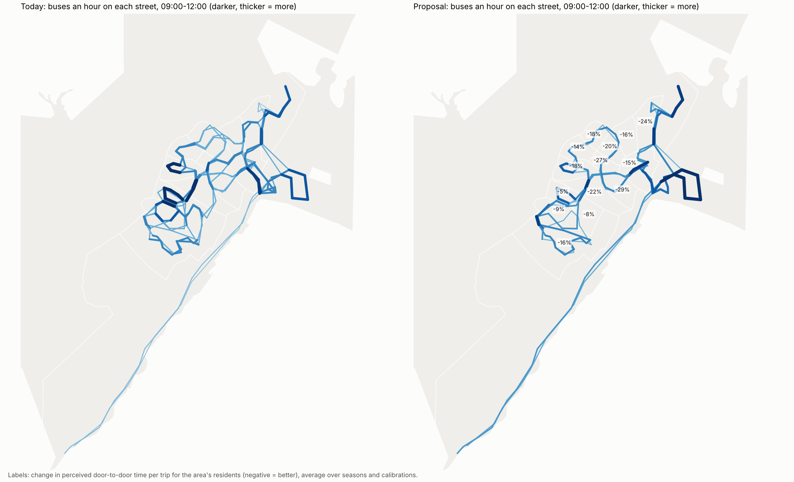

# Eilat urban buses: a better network on the same budget

**The answer:** yes. With the same buses and the same bus-hours as today, a reorganised network cuts the
door-to-door time residents and tourists feel by about 20%, and no residential area is worse off. Three
options follow, from the most cautious to the cheapest.

Everything is in this folder:
- method and numbers: [PARAMETERS.md](PARAMETERS.md), [ATTRACTORS.md](ATTRACTORS.md);
- today's network: [FLEET.md](FLEET.md), [ACCESS.md](ACCESS.md);
- code: `eilat/`, `scripts/`.

## How it was done

1. **Today's network.**
   - From the GTFS of 10 Nov 2026: 441 urban trips on a weekday.
   - Run times corrected to what the buses actually take (SIRI, 7 school-term weekdays): 1.24 × the
     timetable on average, 1.5-1.7 × on the south coast.
2. **Demand.**
   - Residents of 14 statistical areas: census population and car ownership.
   - Trips to work, school, services and leisure, plus hotel guests' outings, by period of the day and
     season.
   - Calibrated on Rav-Kav boardings per line, 2025 Q4: 14% error per line, 15% out of sample on 2026 Q1.
   - Two versions are kept, because 8 lines can't tell trip purposes apart (A: fitted; B: leaning on the
     prior mix). Every option must win under both.
3. **Perceived time.**
   - Walking and waiting count 1.6 × a minute on board; walking at midday in the hot seasons counts 2.5 ×.
   - A transfer adds 5 minutes plus the real wait.
   - Riders of lines that share a street board whichever comes first.
4. **Constraints, all as agreed:**
   - no more buses at once and no more bus-hours than today;
   - no area more than 10% worse; coverage kept;
   - lines run all day (09:00-19:00 at least hourly), and frequency changes by at most 2 × from one period
     to the next;
   - existing streets and stops only;
   - school lines 80-82 unchanged.
5. **Search.**
   - Simulated annealing over today's lines plus candidates: lines with detours cut, lines that pass their
     least used stops without stopping, and 42 new direct lines.
   - Then frequencies are tuned per season: one network, three timetables.

## What the search found (the same in every run)

1. **Pass the quiet stops on the long loops.** Lines 5, 6 and 6א pass about 20 of their 70-odd stops without
   stopping. Each of those stops has another stop of the line within 350 m. Each skipped stop saves up to
   30 s, weighted by the chance the bus would have stopped there.
2. **More buses to the south coast:** every 15-24 minutes instead of 30-60, and service in the evening.
   Coral Beach gets 8-11 minutes closer at midday.
3. **More evening service** (19:00-24:00): today it falls to every 30-40 minutes.
4. **Fewer buses early in the morning on the loops,** and a flatter midday peak. The fleet is set by
   12:00-15:00; a flatter peak frees buses.
5. **Two pairs of near-duplicate lines** (1 and 2; 3 and 4) get merged into one line each, at a higher
   frequency (option 2 and 3 only).
6. **New direct lines were almost never chosen.** In this small city, a frequent line through the centre
   beats a direct but rare one.

## The three options

| | 1. Keep every line | 2. Restructure | 3. Restructure, 3 fewer buses |
|---|---|---|---|
| Lines | all of today's, re-routed and re-timed | 3, 5, 6 families + coast; 1, 2, 4 merged away | as 2 |
| Perceived door-to-door time vs today (calibration A / B) | KEEP_A / KEEP_B | **0.796 / 0.812** | **0.785 / 0.802** |
| Worst-off area | KEEP_W | every area better by ≥ 2% | every area better by ≥ 2.6% |
| Buses at once (peak) | KEEP_P | 32 (today 35) | 31-32 |
| Bus-hours a weekday (model) | KEEP_H | 395 (today 395) | 405 |
| Bus trips vs today | KEEP_T | +3% | +4% |

- **Option 3 costs about the same as today:**
  - 3 fewer peak buses ≈ 1.05 M NIS a year less;
  - 10 more bus-hours a weekday ≈ 1.08 M NIS more (360 NIS an hour, measured).
- **The ranking holds under every sensitivity test** (stop cost 20/40 s, transfer penalty 10 min, walk and
  wait weights 1.5/1.75, heat 2.0/3.0, logit scale 0.15, car owners riding more): option 2 stays at
  0.75-0.82 and option 3 at 0.73-0.81.

### Who gains and who loses (option 2, 09:00-12:00, median over areas, perceived minutes)

| Destination | Change |
|---|---|
| Coral Beach | **-8** |
| Star Eilat / old central station | -3 |
| City hall, hospital | 0 |
| Hotels, Big centre | +2 |

- **Mid-morning trips to the hotels and Big get a little slower** in some areas. That is the price of
  merging lines 1 and 4.
- **Evening, midday and coast trips get faster,** and they outweigh it in every area's average.
- Area-by-area numbers: `data/assess_full_warm_areas.csv` and `data/assess_full_warm_traveltime.csv`.

## The future (Star Eilat, old airport, Shifolei HaHar)

FUTURE_TEXT

## What I would check before anyone acts on this

- **Lines 1 and 2 carry ~3,300 boardings a day today.** The model says their riders are better served by
  frequent 3s, 5 and 6, but it also slightly under-predicts lines 2 and 6 (0.80 and 0.76 of reality).
  Option 1 is the safe first step; option 2 should be checked against stop-level Rav-Kav data before
  lines are merged.
- **Skipped stops:** some passengers walk up to 350 m more. Elderly riders and stops near clinics deserve
  a look stop by stop (the list is in the code output).
- **Not modelled:** drivers' shifts, the depot's capacity, and charging of the new electric buses (an
  urban bus here runs well under 250 km a day, so it is probably not binding).
- **The summer holiday is the least certain season.** There is no summer quarter in the Rav-Kav file.
- **The model compares networks;** it doesn't promise a ridership number. The bus-trip change (+3-4%) is
  the model's elasticity, not a forecast.
